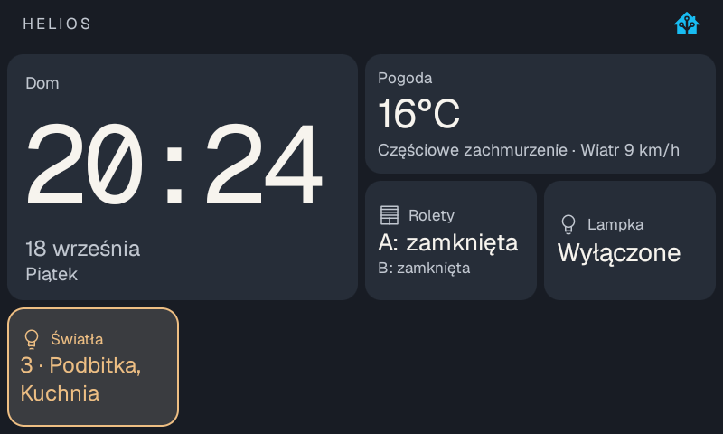

# Helios - a Home Assistant face for the Lenovo Smart Clock 2

Helios turns a Lenovo Smart Clock 2 into a Home Assistant wall panel: a 4x3
dashboard configured entirely from Home Assistant, local "Okay Nabu" wake word
into the HA Assist pipeline, and the clock as a Music Assistant player.

It is a sideloaded Android launcher for one specific piece of hardware. It does
not need Google's services, does not replace your default launcher unless you
ask it to, and talks to nothing but your own Home Assistant.



## Languages

The clock interface supports Polish, English and German. It follows Android's
language by default; for other system languages it falls back to Polish. Open
the Helios menu and tap **Language** to cycle through Automatic, Polski,
English and Deutsch. The choice is saved on the clock and the interface reloads
immediately. Dates and numeric readings use the selected language's formatting.
Names and text supplied by Home Assistant remain as configured there.

The Polish text in the Java source is the fallback. English and German entries
live in `app/src/main/assets/i18n/en.json` and `de.json`. When adding interface
text, wrap the Polish source string with `I18n.t(...)` and add the same key to
both catalogues. Keep protocol identifiers and action keys untranslated.

The English translations were adapted from Mark Graham's
[English interface fork](https://github.com/markgraham924/helios/commit/995ec6b4be6b51629a505d0d94d053f4943786d1).
The application keeps its own update source and package identity.

## What it does

- **Dashboard from Home Assistant.** A 4x3 grid of tiles - a clock, weather, a
  music tile, a generic `tile` for an entity of any domain, and an `entities`
  card with 1-3 readings and their units - described in the
  `helios` section of a Lovelace dashboard. Saving the YAML re-renders the clock;
  no new APK. Tiles can be conditional on any HA entity state, carry any icon
  from the bundled Material Design Icons set, and a document can hold several
  pages. A tap is an *intent* (`toggle`, `close`, `lock`, `activate`, `details`,
  ...), not a service name: the clock picks the service itself from a fixed table
  and always targets the entity written in that same tile, so no YAML can name a
  service, a URL or a foreign target. Unknown fields, a bad icon or a wrong
  domain reject the whole document and the previous layout stays on screen. See
  [docs/ha-dashboard.md](docs/ha-dashboard.md) and
  [docs/SPEC-0.15-dashboard-cards.md](docs/SPEC-0.15-dashboard-cards.md).
- **Extra cards.** `spotify` opens the installed Spotify app, `assistant` starts
  a conversation with Home Assistant Assist, and `predbat` displays the current
  Predbat state and its active `detail` attribute. The last card is read-only.
  All three require clock version 0.20 or newer and dashboard schema 6. Add them
  through the visual editor in `ha-helios` 0.21 or newer, or use the examples in
  [docs/ha-dashboard.md](docs/ha-dashboard.md). These cards were adapted from
  Mark Graham's [shortcut cards](https://github.com/markgraham924/helios/commit/c61dcafc2ee75bdca99914c785a6545a80d60eeb)
  and [Predbat card](https://github.com/markgraham924/helios/commit/20a1b92912bbd3f7c9091f32235ba01edf57361c).
- **Today at a glance.** The read-only `day_plan` card shows the next remaining
  event from a selected HA calendar and up to two open items from an optional
  HA to-do list. It refreshes every five minutes over the existing authenticated
  WebSocket connection. Add it in the companion editor or follow the YAML
  example in [docs/ha-dashboard.md](docs/ha-dashboard.md). The clock needs
  version 0.21 or newer; the editor needs `ha-helios` 0.21 or newer.
- **Screensaver.** After a quiet minute the clock can fall back to a dim clock
  face - always, only in a dark room, or never. The mode, the timings and the
  light thresholds come from Home Assistant, the darkness from the built-in
  light sensor, and a tile that wants attention keeps the panel awake. The
  background can be a slideshow from your own photo storage. See
  [docs/SPEC-0.14-wygaszacz-zdjecia.md](docs/SPEC-0.14-wygaszacz-zdjecia.md).
- **Voice.** Always-on local wake word detection ("Okay Nabu", microWakeWord
  ARMv7 engine with a pinned model). Nothing is recorded or sent before the
  wake word fires; then the microphone streams to the HA Assist pipeline over
  the same WebSocket. The clock's hardware microphone switch is the mute
  control. Follow-up turns stay in the same conversation for a few seconds.
- **Music Assistant.** The clock registers as a local Sendspin player (48 kHz
  PCM) and can also drive your other players: a library browser with search and
  recent items, a slide-out now-playing panel, and a full-screen player.
  Assist ducks or pauses the music while you talk.
- **A device in Home Assistant.** The companion integration
  [SychPL/ha-helios](https://github.com/SychPL/ha-helios) creates a device with
  sensors (app version, voice state, dock), a light for the dock lamp, a volume
  number and a media player. Assigning the device to an area gives your voice
  commands room context.
- **Pairing without tokens.** The clock finds Home Assistant over mDNS (or you
  type the address), Home Assistant shows a six-digit code, and the integration
  mints the clock its own non-admin, local-only user. No long-lived admin token
  ever touches the device. See [docs/SPEC-0.10-onboarding.md](docs/SPEC-0.10-onboarding.md).

## Clock tools

The clock ships with no ADB and no way to grant an app anything, which is why some of the useful things a wall
panel wants (its own microphone permission, system brightness, coming back after a power cut, updating itself
without a dialog) are out of reach. The menu entry **Narzędzia zegara** talks to
[smartclock2tool](https://github.com/SychPL/smartclock2tool) for exactly those, through a bridge with a closed list
of operations.

Helios never receives root or a shell through this. It asks, the tool shows you what is being asked and by whom,
and after you agree the result is a permission Helios then uses on its own. Without the tool installed the entry
offers to fetch it and nothing else changes. The contract is [SPEC 0.12](docs/SPEC-0.12-tools-bridge.md).

## Hardware and firmware

Built and verified on a **Lenovo Smart Clock 2** (MT8167, Android 10), retail
firmware `LenovoCD-24502F_ROW_1.2.2.627_220105`. The dock lamp and phone
charging detection use the OEM binder service of the Lenovo charging dock, so
those two features need the dock; everything else works without it.

The clock ships with no launcher, no browser and no ADB. Getting an APK onto it
for the first time is the hard part, and it is covered in
**[docs/INSTALL.md](docs/INSTALL.md)** - either with ADB over Wi-Fi via
[smartclock2tool](https://github.com/SychPL/smartclock2tool), or with the
TalkBack trick that needs no cable and no root.

## Install

1. Get an APK onto the clock - [docs/INSTALL.md](docs/INSTALL.md).
2. Install the Home Assistant integration from HACS as a custom repository:
   `https://github.com/SychPL/ha-helios`, then restart Home Assistant.
3. Pair: on the clock pick your Home Assistant, in Home Assistant add the
   **Helios** integration, type the six-digit code on the clock.
4. Optional: publish a dashboard. The `ha/` directory holds example manifests
   and `tools/` holds the publishers. Read
   [docs/ha-dashboard.md](docs/ha-dashboard.md) first - the manifests describe
   one particular home and are meant to be edited, not deployed as they are.

Full walkthrough with screenshots: [docs/ha-integration.md](docs/ha-integration.md)
(Polish; an English summary is in [docs/INSTALL.md](docs/INSTALL.md)).

## Build

```bash
export JAVA_HOME="/path/to/jbr"        # the JDK that ships with Android Studio
./gradlew testDebugUnitTest assembleDebug lintDebug
```

`local.properties` points at your Android SDK; platform 35 and build-tools
36.0.0 are needed. The result is `app/build/outputs/apk/debug/app-debug.apk`.
Java 8 language level, minSdk 27 and targetSdk 29, no AndroidX - the clock runs
Android 10 and the app is deliberately small and old-fashioned.

The wake-word model, the ARMv7 engine and the fonts are vendored with their
licenses and SHA-256 provenance under `app/src/main/assets/` and
`app/src/main/jniLibs/`.

## Version compatibility

Starting with 0.21, the app and `ha-helios` use the same major and minor number
for a feature release: Helios 0.21.x pairs with `ha-helios` 0.21.x. Patch
numbers can advance independently. The editor shows each paired clock's app
version and the minimum app version required by the dashboard. It refuses to
save if any clock using that dashboard is older or its version is unknown.
Update those clocks first, or give the newer clock its own dashboard. Older
cards can still run on older app versions; the editor checks the actual cards.
The device WebSocket protocol has its own version number.

## Status and scope

This is a personal project that happens to be useful. It is verified on exactly
one clock, one Home Assistant (2026.8.3) and one Music Assistant (2.10.3). The
device protocol between the app and the integration is versioned separately.

Documentation is mostly in Polish: the specifications under `docs/` (`SPEC-*`)
are the authoritative description of every feature, and `docs/INSTALL.md` plus
this README are the English entry points. Issues and pull requests in English
are welcome.

## Licensing

Apache License 2.0 - see [LICENSE](LICENSE) and [NOTICE](NOTICE). The app
vendors code and a model from the Home Assistant Android companion app under
the same license; attribution and provenance are in `NOTICE` and in the
`provenance.json` files next to the vendored assets.

## Related repositories

- [SychPL/ha-helios](https://github.com/SychPL/ha-helios) - the Home Assistant
  integration (HACS).
- [SychPL/smartclock2tool](https://github.com/SychPL/smartclock2tool) - root,
  ADB over Wi-Fi and SSH on the Smart Clock 2, and the install trick that needs
  neither.

The Polish README that documented the 0.5 to 0.8 development is kept as
[README.pl.md](README.pl.md).
